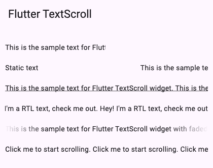

# text_scroll

`TextScroll` is a Flutter widget that scrolls text which doesn't fit its space (marquee text). Text that fits stays still.



## Features

- `endless` and `bouncing` modes
- custom speed, a delay before the first round, and pauses between rounds and at the bounce
- a limited number of rounds
- `style`, `textAlign` and right-to-left text
- selectable text
- faded edges

## Installation

```sh
flutter pub add text_scroll
```

It requires Dart 3.11 and Flutter 3.41 or newer.

## Usage

```dart
import 'package:text_scroll/text_scroll.dart';

TextScroll('This is the sample text for Flutter TextScroll widget. ')
```

With custom settings:

```dart
TextScroll(
  'This is the sample text for Flutter TextScroll widget. ',
  mode: TextScrollMode.bouncing,
  velocity: Velocity(pixelsPerSecond: Offset(150, 0)),
  delayBefore: Duration(milliseconds: 500),
  numberOfReps: 5,
  pauseBetween: Duration(milliseconds: 50),
  pauseOnBounce: Duration(milliseconds: 300),
  style: TextStyle(color: Colors.green),
  textAlign: TextAlign.right,
  selectable: true,
)
```

## Modes

- `TextScrollMode.endless` (default) scrolls in one direction and loops. The text is followed by a copy of itself, `intervalSpaces` apart, so the loop has no visible jump.
- `TextScrollMode.bouncing` scrolls to the end, then back to the start.

## Parameters

| Parameter | Default | What it does |
|---|---|---|
| `text` | — | The text to show. Scrolls only when it doesn't fit. |
| `mode` | `TextScrollMode.endless` | `endless` or `bouncing`. |
| `velocity` | 80 px/s | Scroll speed, from `pixelsPerSecond.dx`. Zero or negative stands still. |
| `delayBefore` | none | Delay before the first round. |
| `pauseBetween` | none | Pause at the start of every next round. |
| `pauseOnBounce` | none | Pause at the end before turning back (`bouncing`). |
| `numberOfReps` | unlimited | How many full rounds to scroll before stopping. |
| `intervalSpaces` | 1 | Spaces between the text and its copy (`endless` only). |
| `style` | none | The text's `TextStyle`. |
| `textAlign` | none | Alignment when the text fits. |
| `textDirection` | `TextDirection.ltr` | Text direction. Right-to-left text scrolls from left to right. |
| `selectable` | `false` | Renders a `SelectableText`, so the text can be selected and copied. |
| `fadedBorder` | `false` | Fades the text out towards the edges. |
| `fadedBorderWidth` | `0.2` | Width of the fade, as a fraction of the widget's width. |
| `fadeBorderSide` | `FadeBorderSide.both` | Which edges fade: `left`, `right` or `both`. |
| `fadeBorderVisibility` | `FadeBorderVisibility.auto` | `auto` fades only text that doesn't fit; `always` fades any text. |

## Changing parameters

`TextScroll` restarts from the start when `text`, `mode`, `velocity`, `intervalSpaces` or a layout-changing `style` changes, so a new value takes effect at once. A change in color only does not restart. Pauses and timers are cancelled when the widget is disposed.

## See also

- [GitHub repository](https://github.com/yurii-khi/text_scroll)
- [pub.dev package](https://pub.dev/packages/text_scroll)
- [API reference](https://pub.dev/documentation/text_scroll/latest/text_scroll/TextScroll-class.html)
